# Guía de Arquitectura y Desarrollo en Go — Wompi Webhook Gateway

Este documento explica paso a paso cómo fue diseñado y construido **Wompi Webhook Gateway**, tanto desde la perspectiva de **Arquitectura de Software (Hexagonal / Clean Architecture)** como de los **fundamentos del lenguaje Go** aplicados en producción.

---

## 1. Diagramas Interactivos (Archify)

El proyecto cuenta con dos diagramas interactivos generados y validados con **Archify** (puedes abrirlos directamente en el navegador; incluyen inspección de código fuente enlazada a GitHub, modo claro/oscuro y exportación a PNG/SVG):

- **Diagrama de Arquitectura Hexagonal**: [`.archify/architecture-wompi-gateway-20261022-173700/wompi-gateway.html`](../.archify/architecture-wompi-gateway-20261022-173700/wompi-gateway.html)
- **Diagrama de Flujo y Ciclo de Reintentos**: [`.archify/workflow-webhook-lifecycle-20261022-173700/webhook-lifecycle.html`](../.archify/workflow-webhook-lifecycle-20261022-173700/webhook-lifecycle.html)

### Vista rápida del flujo (Mermaid)

```mermaid
flowchart LR
    W["Wompi Platform"] -->|"POST /webhooks/wompi/:slug"| C["Caddy Proxy (TLS)"]
    C --> H["Gin Handler (ReceiveWompiWebhook)"]
    H --> V["Verifier (SHA-256 + hmac.Equal)"]
    V -->|"Inválido"| R401["HTTP 401 Unauthorized"]
    V -->|"Válido"| M["Prefix Router (MatchRoute)"]
    M -->|"Coincide (sub-, mw-sub-, *)"| DB[("PostgreSQL 16")]
    M -->|"Sin regla activa"| U["Estado: unrouted (200 OK)"]
    DB -->|"notifyCh / Ticker"| D["Dispatcher Worker Pool"]
    D -->|"POST RawPayload + X-Event-Checksum"| T["Proyecto Destino (Optimax / Mr. Waiters)"]
    T -->|"2xx OK"| OK["Estado: delivered"]
    T -->|"Error / Timeout / 5xx"| B["Backoff Exponencial (30s..6h) -> dead_letter"]
```



---

## 2. Estructura del Proyecto y el directorio `internal/` en Go

```text
wompi/
├── cmd/
│   └── server/
│       └── main.go                  # Punto de entrada (Composition Root)
├── internal/                        # Código privado del módulo (protegido por el compilador de Go)
│   ├── config/
│   │   └── config.go                # Carga de variables de entorno y armado seguro de DSN
│   ├── domain/
│   │   ├── entities.go              # Entidades puras del dominio (sin dependencias externas)
│   │   └── repository.go            # Puerto de persistencia (interfaz Repository)
│   ├── wompi/
│   │   ├── verifier.go              # Verificador criptográfico de eventos de Wompi
│   │   └── verifier_test.go         # Pruebas unitarias de firma y tipos numéricos
│   ├── dispatcher/
│   │   ├── router.go                # Algoritmo de enrutamiento por prefijo más específico
│   │   ├── router_test.go           # Pruebas de colisión de prefijos y comodín (*)
│   │   ├── dispatcher.go            # Pool de goroutines, canales y backoff exponencial
│   │   └── dispatcher_test.go       # Pruebas de concurrencia, reenvío y dead_letter
│   ├── repository/
│   │   ├── memory/
│   │   │   └── repository.go        # Adaptador en memoria (con sync.RWMutex) para tests rápidos
│   │   └── postgres/
│   │       ├── migrations/
│   │       │   └── 001_init.sql     # Esquema SQL embebido en el binario
│   │       └── repository.go        # Adaptador PostgreSQL con pgxpool y SKIP LOCKED
│   └── http/
│       ├── router.go                # Rutas HTTP en Gin y directiva //go:embed para la UI
│       ├── middleware.go            # Autenticación por cookie HttpOnly HMAC y X-API-Key
│       ├── handlers.go              # Controladores de webhooks y API de administración
│       ├── router_test.go           # Pruebas de integración de punta a punta
│       └── ui/
│           └── index.html           # Consola de operaciones embebida en el ejecutable
├── Dockerfile                       # Build multi-etapa (binario estático CGO_ENABLED=0)
├── docker-compose.yml               # Entorno local (postgres + gateway)
├── docker-compose.prod.yml          # Entorno de producción (postgres + gateway + caddy)
└── Caddyfile                        # Proxy inverso con TLS automático
```

### Conceptos clave de Go en esta estructura:
1. **`cmd/server/main.go` (Composition Root)**: En Go, cada ejecutable vive bajo `cmd/<nombre>/main.go`. Su única responsabilidad es leer la configuración, inicializar las dependencias concretas (la conexión a PostgreSQL, el `Dispatcher`, el router de `Gin`) e inyectarlas.
2. **El directorio especial `internal/`**: No es solo una convención de nombres; el compilador de Go **prohíbe** que cualquier paquete externo importe código ubicado dentro de `internal/`. Esto garantiza encapsulamiento real de tu arquitectura.
3. **Interfaces implícitas (`internal/domain/repository.go`)**:
   En Go no existe la palabra clave `implements`. Si una estructura (`PostgresRepository` o `MemoryRepository`) define todos los métodos declarados en `domain.Repository`, satisface la interfaz automáticamente:
   - Permite que `internal/domain` no importe ni conozca `pgx` ni SQL.
   - Permite correr toda la suite de pruebas (`go test -race ./...`) en milisegundos usando `memory.New()` sin requerir una base de datos levantada, mientras en producción se inyecta `postgres.New(pool)`.

---

## 3. Verificación Criptográfica y el problema de `float64` en JSON (`internal/wompi/verifier.go`)

Cuando Wompi envía un webhook, incluye un bloque `signature` como este:

```json
{
  "data": {
    "transaction": {
      "id": "1234-abcd",
      "status": "APPROVED",
      "amount_in_cents": 12900000,
      "reference": "mw-sub-rest01-9f8a7b"
    }
  },
  "signature": {
    "properties": [
      "transaction.id",
      "transaction.status",
      "transaction.amount_in_cents"
    ],
    "checksum": "a8f5..."
  },
  "timestamp": 1700001000
}
```

### Lección 1: Por qué usar `decoder.UseNumber()` en Go
Si en Go haces `json.Unmarshal(raw, &mapaGenerico)` hacia un `map[string]any`, el paquete `encoding/json` convierte todos los números de JSON en `float64`. Al convertir un `float64` grande a texto con `fmt.Sprint()`, Go puede formatearlo en notación científica (`1.29e+07` en lugar de `"12900000"`), lo que cambia la cadena concatenada y hace fallar el hash SHA-256.

En `internal/wompi/verifier.go` lo resolvemos así:

```go
decoder := json.NewDecoder(bytes.NewReader(rawBody))
decoder.UseNumber() // Mantiene los números como el literal exacto json.Number (string)
```

De este modo, `amount_in_cents` conserva exactamente los dígitos que envió Wompi.

### Lección 2: Comparación en tiempo constante (`hmac.Equal`)
Nunca se debe comparar un hash o un API Key con `==` en un endpoint público. El operador `==` compara byte por byte y retorna `false` en el primer carácter distinto, filtrando por tiempo de respuesta cuántos caracteres iniciales acertó un atacante (ataque de timing). Por eso usamos `hmac.Equal`:

```go
return hmac.Equal([]byte(strings.ToLower(computedHex)), []byte(strings.ToLower(expectedChecksum)))
```

### Lección 3: Reenvío del `RawPayload` sin alterar un solo byte
Tanto **Optimax** como **Mr. Waiters** ya tienen su propia validación de firma de Wompi. Si el gateway deserializara el JSON y lo volviera a serializar antes de reenviarlo, cambiaría el orden de las llaves o los espacios, aunque el checksum se calcula sobre propiedades, es buena práctica en gateways de webhooks guardar y reenviar exactamente el `[]byte` original (`RawPayload`) junto con la cabecera `X-Event-Checksum`.

---

## 4. Enrutamiento por Prefijo de Referencia (`internal/dispatcher/router.go`)

Como Wompi solo permite configurar **una única URL de eventos** por cuenta comercial, distinguimos a qué sistema pertenece cada pago por el prefijo de `data.transaction.reference`:

- `sub-...` → **Optimax**
- `mw-sub-...` → **Mr. Waiters**
- `*` o vacío `""` → **Ruta comodín (Catch-All)** opcional

El algoritmo en `MatchRoute`:
1. Filtra únicamente las reglas activas (`rule.Active == true`).
2. Evalúa todas las reglas con prefijo específico que cumplan `strings.HasPrefix(reference, prefix)`.
3. Las ordena por **longitud de prefijo de mayor a menor** (el prefijo más específico siempre gana: por ejemplo, `sub-vip-` gana sobre `sub-`, y `mw-sub-` jamás colisiona con `sub-`), desempatando por mayor `Priority`.
4. Si ningún prefijo específico coincide, busca si existe una regla comodín (`*`).
5. Si tampoco hay comodín, el evento **no se descarta**: se guarda en PostgreSQL con estado `unrouted` y se responde `200 OK` a Wompi. Luego, desde `/admin`, puedes crear la regla faltante y presionar **Re-Route** (`POST /api/v1/events/:id/route`) para encolar su entrega sin perder la notificación.

---

## 5. Concurrencia en Go: Goroutines, Canales y Context (`internal/dispatcher/dispatcher.go`)

El motor de envíos y reintentos (`Dispatcher`) muestra cuatro patrones idiomáticos de concurrencia en Go:

### A. Canal de notificación no bloqueante (`notifyCh`)
Queremos que cuando llegue un webhook, el worker lo envíe de inmediato sin esperar al próximo ciclo del reloj (`Ticker`), pero tampoco queremos que el handler HTTP de Wompi se bloquee si todos los workers están ocupados:

```go
// Canal con buffer de capacidad 1
notifyCh: make(chan struct{}, 1)

// Notify despierta al worker sin bloquear jamás al llamador
func (d *Dispatcher) Notify() {
    select {
    case d.notifyCh <- struct{}{}:
    default:
        // Si ya hay una señal pendiente en el buffer, no hace falta encolar otra
    }
}
```

### B. Multiplexación de eventos con `select` en `Start(ctx)`
Una única goroutine coordinadora escucha tres fuentes de eventos simultáneamente usando `select`:

```go
for {
    select {
    case <-ctx.Done():
        // El servidor recibió SIGINT o SIGTERM: salimos limpiamente
        return
    case <-d.notifyCh:
        // Llegó un webhook nuevo o un reintento manual
        d.ProcessDueBatch(ctx)
    case <-ticker.C:
        // Cada 5 segundos revisamos si venció el backoff de algún reintento
        d.ProcessDueBatch(ctx)
    }
}
```

### C. Pool acotado con semáforo de canal y `sync.WaitGroup`
Para evitar abrir miles de conexiones salientes simultáneas si se acumulan eventos, acotamos la concurrencia con un canal con buffer (`sem := make(chan struct{}, d.concurrency)`):

```go
sem := make(chan struct{}, d.concurrency)
var wg sync.WaitGroup

for _, del := range deliveries {
    wg.Add(1)
    sem <- struct{}{} // Adquiere un turno (bloquea si ya hay N goroutines activas)
    go func(delivery *domain.WebhookDelivery) {
        defer wg.Done()
        defer func() { <-sem }() // Libera el turno al terminar
        d.deliverOne(ctx, delivery)
    }(del)
}

wg.Wait()
```

### D. Backoff Exponencial con Jitter
Si el proyecto destino está caído o responde `500`, reintentar cada segundo saturaría el servidor. `DefaultBackoff` aplica una curva exponencial (`30s`, `2m`, `10m`, `1h`, `6h`) multiplicada por un factor aleatorio de ±10% (**jitter**) para evitar que cientos de webhooks que fallaron juntos reintenten exactamente en el mismo milisegundo (*thundering herd*). Al alcanzar `MaxRetries`, la entrega pasa a estado `dead_letter`.

---

## 6. Escalado Horizontal en PostgreSQL con `FOR UPDATE SKIP LOCKED`

En `internal/repository/postgres/repository.go`, el método `ClaimDueDeliveries` reclama los webhooks pendientes usando una transacción con `FOR UPDATE SKIP LOCKED`:

```sql
WITH claimed AS (
    SELECT d.id
    FROM webhook_deliveries d
    WHERE d.status IN ('pending', 'retrying')
      AND d.next_retry_at <= NOW()
    ORDER BY d.next_retry_at ASC
    LIMIT $1
    FOR UPDATE SKIP LOCKED
)
UPDATE webhook_deliveries d
SET next_retry_at = $2, updated_at = NOW()
FROM claimed
WHERE d.id = claimed.id
RETURNING ...
```

¿Por qué es tan importante `FOR UPDATE SKIP LOCKED`?
Si mañana levantas **3 contenedores** de `wompi-gateway` apuntando a la misma base PostgreSQL, cuando dos instancias consultan la cola al mismo tiempo, PostgreSQL salta las filas que otra instancia ya está reclamando en lugar de bloquearse o entregar el mismo webhook dos veces.

---

## 7. Binario Único con `//go:embed`, Cookies `HttpOnly` y Apagado Elegante

1. **`//go:embed`**:
   Tanto el archivo SQL de migración (`internal/repository/postgres/migrations/001_init.sql`) como la consola de administración (`internal/http/ui/index.html`) se incrustan dentro del binario en tiempo de compilación mediante la directiva `//go:embed`. Gracias a eso, la imagen final de Docker (`FROM alpine:3.21`) solo contiene el ejecutable `/app/wompi-gateway` y pesa apenas unos megabytes.
2. **Sesiones seguras con Cookie `HttpOnly` + `SameSite=Strict` (`internal/http/middleware.go`)**:
   Al iniciar sesión en `/admin` (`POST /api/v1/auth/login`), el backend verifica `ADMIN_API_KEY` con `hmac.Equal` y emite una cookie `wompi_admin_session` firmada con `HMAC-SHA256` y vencimiento de 12 horas:
   - `HttpOnly: true`: Ningún script en el navegador (`document.cookie`) puede leerla, protegiendo contra XSS.
   - `SameSite: Strict`: Evita ataques CSRF.
   - `Secure: true`: Se activa automáticamente cuando Caddy envía `X-Forwarded-Proto: https`.
3. **Graceful Shutdown (`cmd/server/main.go`)**:
   Con `signal.NotifyContext(context.Background(), syscall.SIGINT, syscall.SIGTERM)`, cuando Docker detiene el contenedor para actualizar la imagen, Go deja de aceptar peticiones nuevas pero otorga hasta 15 segundos (`srv.Shutdown`) para que cualquier webhook en vuelo termine de procesarse y guardarse en PostgreSQL sin cortar conexiones a la mitad.
